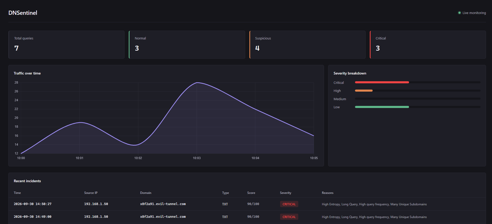
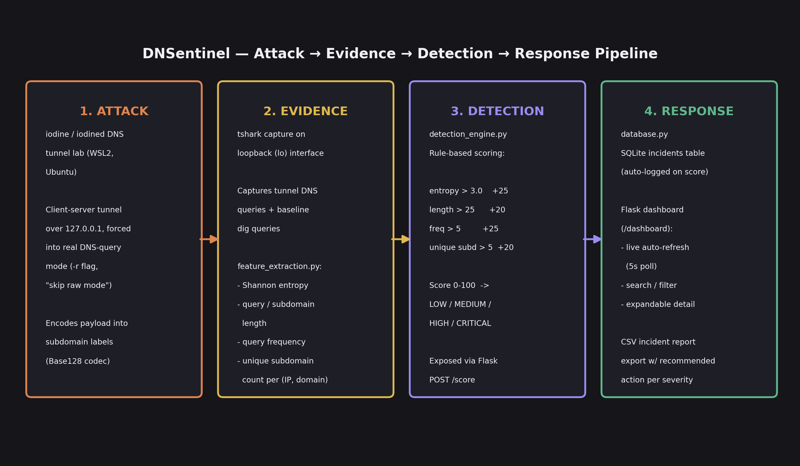

# 🛡️ DNSentinel

**DNS Tunneling Attack Detection & Network Threat Monitoring System**


DNSentinel detects **DNS tunneling**, a technique where attackers hide stolen data or command-and-control traffic inside DNS queries, using a rule-based scoring engine over four behavioural features. It was built and validated end to end: a real attack lab, real captured evidence, a detection engine, persistent incident logging, and a live dashboard.



---

## Why this exists

DNS is allowed through almost every firewall, and each tunneling query looks like a valid lookup, so individual queries rarely raise alarms. The signal is in the **pattern**: long, random-looking subdomains, sent frequently, with a new unique subdomain almost every time. DNSentinel scores those patterns and explains every verdict.

## Pipeline: Attack → Evidence → Detection → Response



| Stage | What happens | Where |
|---|---|---|
| **Attack** | A real DNS tunnel is run with `iodine`/`iodined` in an isolated WSL2 lab, forced into genuine DNS-query mode (`-r`) | WSL2 (Ubuntu) |
| **Evidence** | Traffic is captured with `tshark`; features are extracted from queries | `feature_extraction.py`, `analyze_pcap.py` |
| **Detection** | Four threshold rules produce a 0–100 risk score and severity, with named reasons | `detection_engine.py` |
| **Response** | Incidents are logged to SQLite, shown on a live dashboard, and exportable as a CSV report | `database.py`, `app.py`, `templates/dashboard.html` |

## Detection logic

Each query group (per source IP and base domain) is checked against four rules:

| Rule | Condition | Points |
|---|---|---|
| High entropy | Shannon entropy > 3.0 | +25 |
| Long query | Query length > 25 characters | +20 |
| High query frequency | More than 5 queries to the same base domain | +25 |
| Many unique subdomains | More than 5 distinct subdomains for the same base domain | +20 |

| Score | Severity |
|---|---|
| 0–29 | 🟢 LOW |
| 30–59 | 🟡 MEDIUM |
| 60–79 | 🟠 HIGH |
| 80–100 | 🔴 CRITICAL |

> The four implemented rules currently total a maximum of 90 points. The "unusual pattern" rule (+10) from the original design is planned future work.

## Results

Validated against a **real iodine tunnel capture** and a **normal DNS baseline** captured in the same session:

| Traffic | Avg. entropy | Score | Severity |
|---|---|---|---|
| iodine tunnel (`t.example.com`) | 3.60 | 70 / 100 | 🟠 HIGH (entropy, frequency, unique subdomains triggered) |
| google.com | 2.65 | 0 / 100 | 🟢 LOW |
| github.com | 3.32 | 25 / 100 | 🟢 LOW |
| wikipedia.org | 3.33 | 25 / 100 | 🟢 LOW |

Short legitimate domains can trigger the entropy rule alone, but a single rule is not enough to cross into an alerting severity. That is the reason for combining four features.

## Features

- Rule-based detector with an **explainable** score (every verdict lists the rules that fired)
- Flask scoring API with automatic **SQLite incident logging**
- Live dashboard: stat cards, severity breakdown, auto-refresh every 5 seconds
- Searchable and filterable incident table with expandable per-incident detail
- **CSV incident report** export with a recommended action per severity
- **Real-time capture** with Scapy: sniffs live DNS (UDP/53) on the host, deduplicates, tracks per-domain state, scores each query as it arrives
- Synthetic labelled dataset generator (200 normal + 50 tunneling queries) used to calibrate thresholds

> The "Traffic over time" chart currently shows static sample data and is not yet driven by real incident timestamps.

## Project structure

```
dnsentinel/
├── app.py                  # Flask app: /score, /dashboard, /api/incidents, /export/csv
├── database.py             # SQLite schema + insert/fetch helpers
├── detection_engine.py     # Risk scoring, severity bands, recommended actions
├── feature_extraction.py   # Entropy, length, base domain, frequency, unique subdomains
├── generate_dataset.py     # Synthetic labelled DNS dataset
├── realtime_capture.py     # Live Scapy capture + scoring
├── analyze_pcap.py         # Entropy comparison on real captured traffic
├── test_endpoint.py        # Manual test of POST /score
├── test_pcap_scoring.py    # Scores real pcap-derived data via /score
├── templates/
│   └── dashboard.html      # Dashboard UI (Chart.js)
├── dns_dataset.csv         # Synthetic dataset
├── pcap_queries.csv        # Queries extracted from the real tunnel capture
└── requirements.txt
```

## Quick start

```powershell
git clone https://github.com/arpitasen060605/dnsentinel.git
cd dnsentinel
python -m venv .venv
.venv\Scripts\Activate
pip install -r requirements.txt
python app.py
```

Open **http://127.0.0.1:5000/dashboard**. The database is created automatically on first run. To populate it with example incidents, run these in a second terminal (with the venv active):

```powershell
python test_endpoint.py        # one synthetic CRITICAL example
python test_pcap_scoring.py    # scores the real tunnel + baseline capture
```

### API

| Method | Endpoint | Purpose |
|---|---|---|
| `POST` | `/score` | Score a query group and log it. Body: `entropy`, `query_length`, `query_frequency`, `unique_subdomain`, `source_ip`, `domain`, `query_type` |
| `GET` | `/dashboard` | Live dashboard |
| `GET` | `/api/incidents` | Incidents and summary stats as JSON |
| `GET` | `/export/csv` | Full incident report as CSV |

### Real-time capture (Windows)

1. Install [Npcap](https://npcap.com/) with **WinPcap API-compatible mode** enabled.
2. Set `MY_IP` in `realtime_capture.py` to your machine's current IPv4 address (`ipconfig`).
3. With `app.py` running, start the sniffer from an **Administrator** terminal:

```powershell
python realtime_capture.py
```

## Reproducing the attack lab (WSL2 / Ubuntu)

> ⚠️ Run this only on your own machine, on loopback. It is a detection-research lab, not an attack tool.

```bash
sudo apt install iodine tshark

# Terminal 1: tunnel server (bind explicitly to loopback)
sudo iodined -l 127.0.0.1 -f 10.0.0.1 t.example.com -P <your-password>

# Terminal 2: tunnel client, forced into real DNS-query mode
sudo iodine -f -r 127.0.0.1 t.example.com -P <your-password>

# Terminal 3: capture while generating tunnel + baseline traffic
sudo tshark -i lo -w /tmp/tunnel_capture.pcap
ping -c 5 10.0.0.1
dig google.com
```

Without `-r`, iodine falls back to a raw-UDP shortcut on localhost and produces no real DNS-formatted queries to analyse.

## Known limitations

Every item below was found by testing, not assumed:

- **Legitimate cloud telemetry can false-positive.** Teams and Grammarly endpoints have scored MEDIUM/HIGH because long, GUID-like subdomains and frequent polling resemble tunneling. An allowlist is the standard mitigation.
- **DNS-over-HTTPS is invisible** to UDP/53 packet capture.
- **Live capture sees one device only**, and cannot see WSL2's isolated loopback; the lab tunnel is validated through the pcap-replay path instead.
- **Thresholds are calibrated on lab and synthetic data**, not a real network baseline.
- **Detection and alerting only**; no automatic blocking.

## Future Scope

- **Automated response:** sinkhole or block flagged domains through a firewall/DNS integration, instead of only logging them
- **More attack variants:** test against dnscat2 and other encodings (hex, base64) to check that the thresholds generalise
- **ML-based detection:** combine the rule score with an Isolation Forest anomaly score
- **Network-wide monitoring:** deploy as a DNS proxy (Pi-hole style) so every device on a network is covered, not just one machine
- **Known-good domain allowlist:** suppress false positives from legitimate cloud telemetry (Teams, Grammarly)
